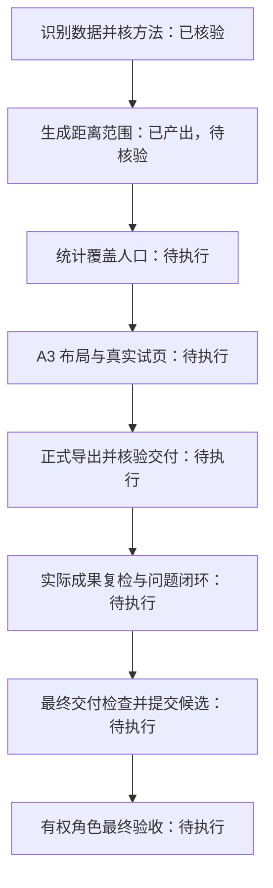

**流程与成果状态板**

**记录来源：** SYNTHETIC\_NOT\_LIVE：流程展示测试；没有运行 GIS，没有生成下列计划成果
**目标：** 学校距离范围分析、人口统计与 A3 制图（模拟过程）
**计划版本：** 1

**▶ 当前执行步骤：** 当前无已观测的执行中步骤
- 待补充确认：旧记录未记录资料与输出位置确认；新任务须补全。
**任务记录状态：** 执行中（内部进度见观测）
**最近记录观测：** 2026-10-18T10:00:05+08:00

以下按提供的记录展示；格式检查不证明 GIS 执行、授权或成果正确。

**选择依据：** 示例假设目标是几何距离范围；真实任务须先核方法、CRS、人口口径与授权，不能用此示例替代。

**步骤核验：** 1/8；这不是耗时进度。

**工具内部进度：** 未提供计数；未知，不生成百分比或预计完成时间。

客户端支持 Mermaid 时可显示流程图；文字步骤表始终保留。

| 步骤 | 依赖 | 状态 | 最新说明与依据 |
|---|---|---|---|
| S1 识别数据并核方法 | 无 | 已核验 | 模拟核验状态，不代表真实数据已检查（依据：DEMO-E1） |
| S2 生成距离范围 | S1 | 已产出，待核验 | 模拟工具成功；仍需空间、单位和数量检查（依据：DEMO-E2） |
| S3 统计覆盖人口 | S2 | 待执行 | 等待范围核验和人口统计口径 |
| S4 A3 布局与真实试页 | S3 | 待执行 | 尚无真实地图预览 |
| S5 正式导出并核验交付 | S4 | 待执行 | 尚未执行，不提供虚构成果链接 |
| S6 实际成果复检与问题闭环 | S5 | 待执行 | 待产生新的复检证据，不复制首次报告 |
| S7 最终交付检查并提交候选 | S6 | 待执行 | 对照需求、完整成员和最终版本逐项检查 |
| S8 有权角色最终验收 | S7 | 待执行 | 制作 Agent 不自批；实际裁定单列在验收记录 |

**质量检查与验收：**

| 阶段 | 必需检查通过数 | 记录状态 |
|---|---|---|
| 资料预检 | 1/1 | 检查通过 |
| 过程与首次检查 | 1/1 | 检查通过 |
| 复检/问题闭环 | 0/1 | 尚未检查 |
| 最终交付检查 | 0/1 | 尚未检查 |

技术候选：尚未具备候选条件；外部验收：尚未提交外部验收。离线格式检查不授予最终 PASS。

| 质量要求 | 判据 | 依据 | 检查覆盖要求 |
|---|---|---|---|
| R1 资料与方法前提（模拟） | 演示判据，真实任务另依技术设计书制定 | SYNTHETIC\_ONLY | 全检 |
| R2 分析成果首检和复检（模拟） | 演示判据，不是实际空间检查结论 | SYNTHETIC\_ONLY | 全检 |
| R3 最终交付成员检查（模拟） | 演示判据，不是行业精度阈值 | SYNTHETIC\_ONLY | 全检 |

| 检查 | 阶段 | 覆盖 | 有效结果 | 证据 |
|---|---|---|---|---|
| DEMO-Q1 / R1 | 资料预检 | FULL 1/1 | 检查通过 | DEMO-E1 |
| DEMO-Q2 / R2 | 过程与首次检查 | FULL 1/1 | 检查通过 | DEMO-E2 |

**下一步：** 完成或配置“复检/问题闭环”；无依据时保持待检查/受阻。

**观测依据摘要（最近 2/2 条）：**

| 依据 | 实际记录时间 | 来源 | 摘要 |
|---|---|---|---|
| DEMO-E1 | 2026-10-18T10:00:00+08:00 | SYNTHETIC\_TEST\_NOT\_SERVER | 模拟 S1 核验事件 |
| DEMO-E2 | 2026-10-18T10:00:05+08:00 | SYNTHETIC\_TEST\_NOT\_SERVER | 模拟一个工具成功返回，尚未质量核验 |

**产物与预览：**

- A3 正式地图（仅计划）：计划输出，尚未生成；路径 D:/GIS/example-owned-output/school\_map\_v1.pdf
